This was my 4th year attending the [Big Ears festival](https://bigearsfestival.org/) in Knoxville, TN and it remains one of my favorite festivals I've attended. The music curation is fantastic, the vibe is easy-going and full of energy and the days all blur together into one multi-genre experience.

I checked into the hotel and walked a few blocks over to the merch venue to pick up a paper program and map/schedule. They had multiple shirts, jackets, hats and sweatshirts featuring the Big Ears logo as well as artist shirts. There was also merch for various artists performing at the festival plus records, books and posters. Each day of the festival new merch would be added so I checked back in over the 4 days to see if anything new caught my eye. I got a teal Big Ears sweatshirt.

After stopping by to check out all the merch it was time to get into the first performance of the festival...

## Thursday - March 27, 2025

### [Yo La Tengo](https://yolatengo.com/) at Mill & Mine
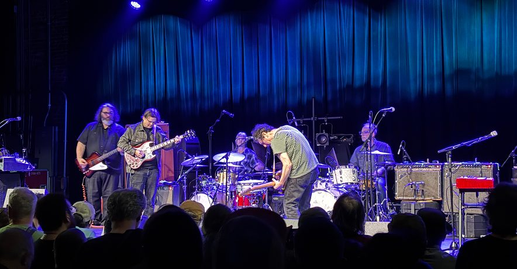

[Setlist](https://www.setlist.fm/setlist/yo-la-tengo/2025/the-mill-and-mine-knoxville-tn-1b58e914.html)

Big Ears cracked open for me with Yo La Tengo. This was one of those bands that had lingered on my list for far too long, always just out of reach. Finally, here they were, filling Mill & Mine with that signature mix of warmth and controlled chaos.

They played like a band that has been doing this for decades. It was not just about skill but instinct. Each note landed exactly where it needed to, yet nothing felt over-rehearsed. “Autumn Sweater” wrapped the crowd in its familiar, hypnotic haze. “I Heard You Looking” stretched out into something cinematic. It was soft one moment and scraping the ceiling the next.

The real magic happened in the breakdowns. Their gentle melodies gave way to feedback-drenched catharsis. It felt like a slow-building storm that finally cracks the sky open. It was not about precision. It was about feeling. In those noisy, sprawling outros, you could feel the pulse of something raw and electric. The whole room leaned in just a little closer.

### [Immersion](https://immersionhq.uk/) at Regas Square
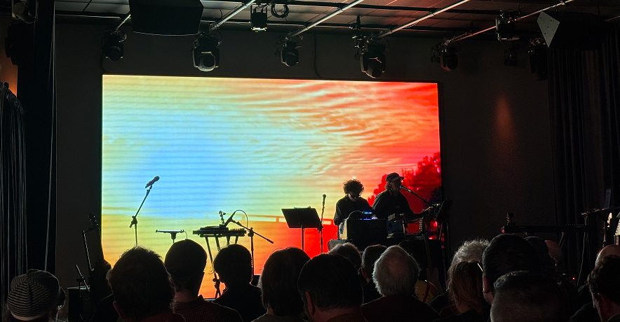

At Regas Square, I was not familiar with Immersion but was intrigued by their connections to [Wire](https://www.pinkflag.com/) and [SUSS](https://www.sussband.com/), both of whom I'm a fan. I quickly shuffled into a packed Regas Square and found a seat in the back. The duo took the stage and embarked on a journey filled with ambient drones, twangy guitar riffs, driving electronic drums, and sequenced blips. Their sound evoked the sensation of a road trip through vast, sunbaked landscapes, with no particular destination in mind. The seamless integration of electronic and organic elements created a rich, immersive experience that resonated deeply.

### [Suss](https://www.sussband.com/) at Regas Square
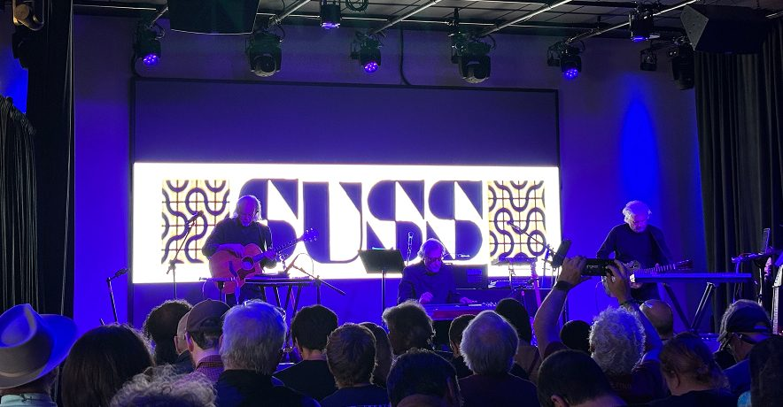

### [Beth Gibbons](https://bethgibbons.net/) at Knoxville Civic Auditorium
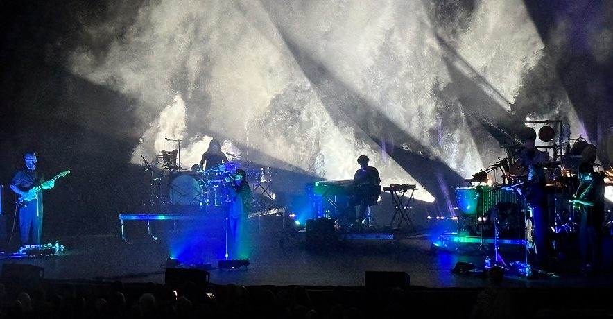

## Friday - March 28, 2025

### [Philip Glass Ensemble](https://philipglassensemble.com/) at Tennessee Theatre
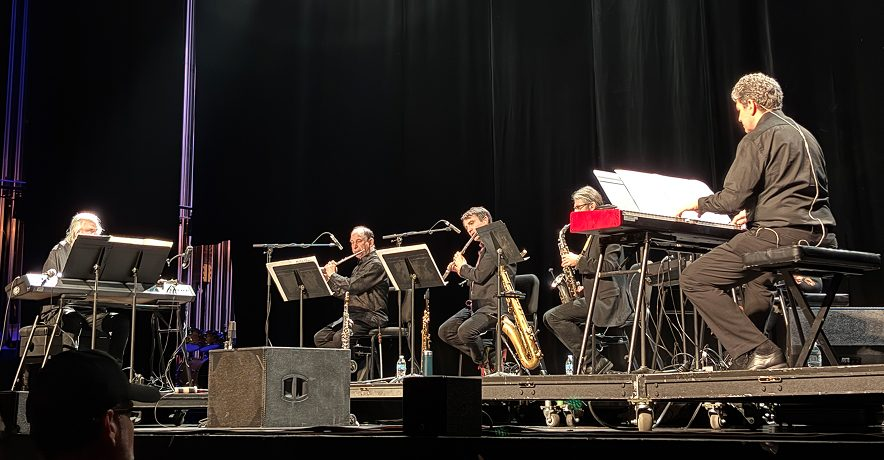

### [Cowboy Sadness](https://cowboysadness.bandcamp.com/album/selected-jambient-works-vol-1) at Church Street United Methodist 
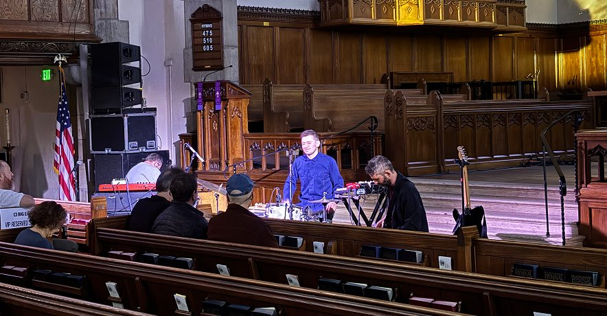

### [Jeff Parker ETA IVtet](https://jeffparkersounds.com/) at Bijou Theatre 
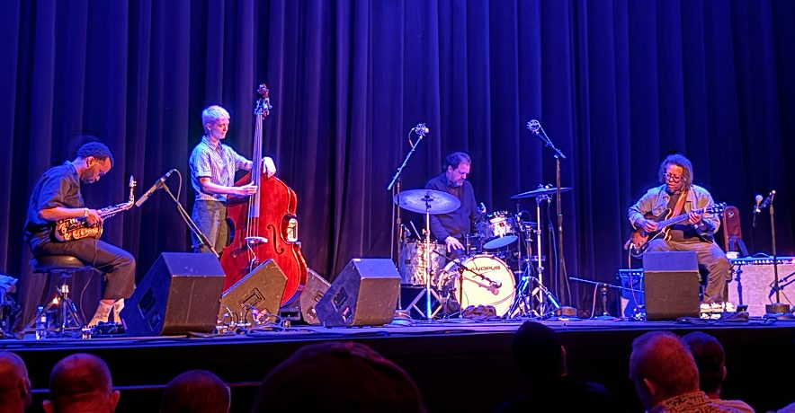

### [Thor Harris](https://www.thorharris.org/) at First Presbyterian Sanctuary
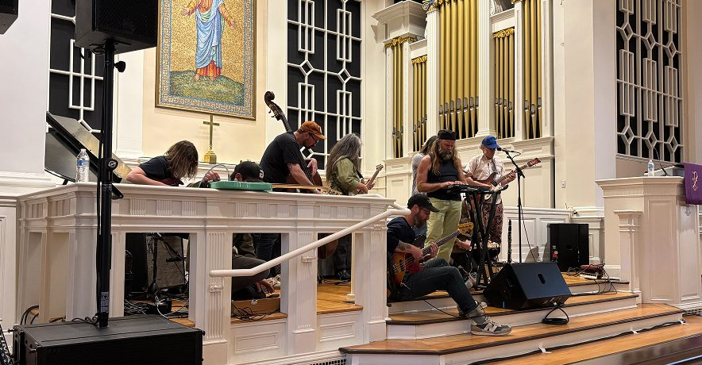

### [Tyshawn Sorey](https://www.tyshawnsorey.com/): Monochromatic Light (Afterlife) at St. John's Cathedral
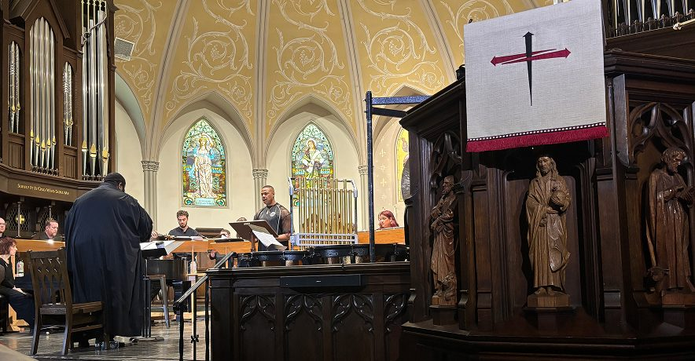

### SUSS: Across the Horizon Nights at The Point
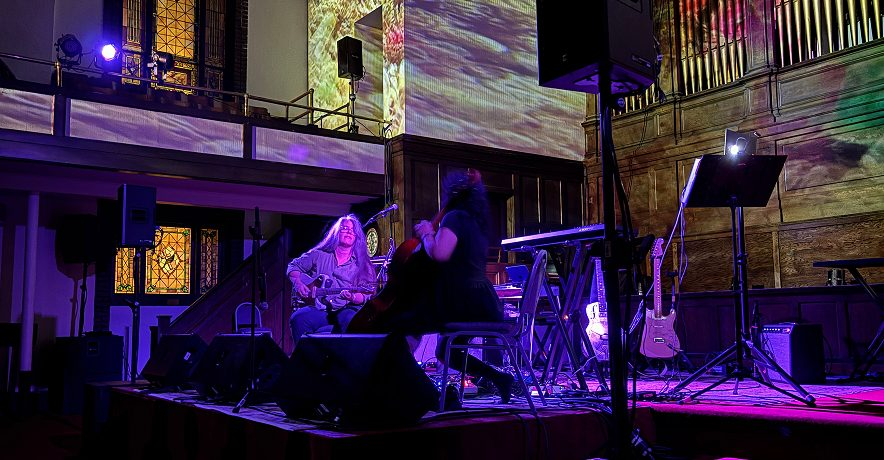

## Saturday - March 29, 2025

### [Philip Glass Ensemble](https://philipglassensemble.com/) at Tennessee Theatre
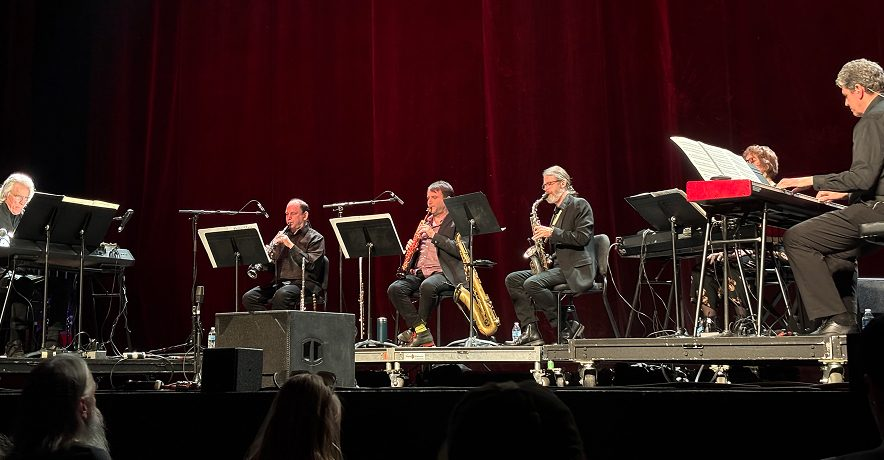

### [Adam Rudolph](https://metarecords.com/adam.html): Sunrise Quartet at Mill & Mine
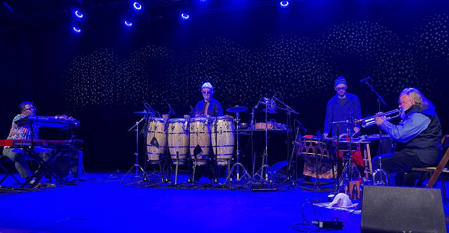

### [Chanel Beads](https://chanelbeads.bandcamp.com/music) at The Standard
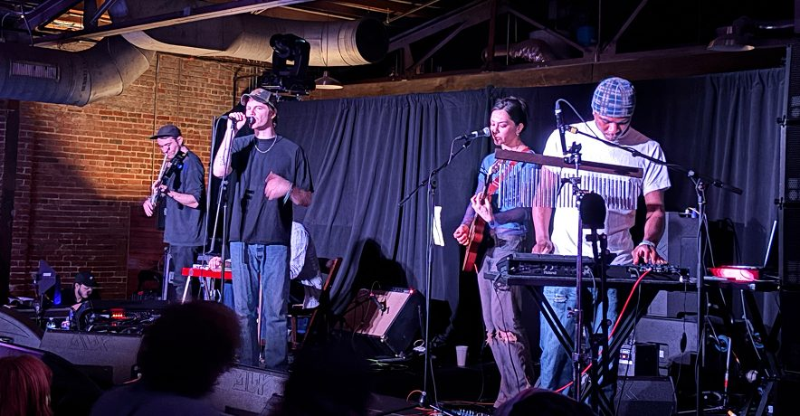

### Tyshawn Sorey, King Britt & Friends - Featuring Melz & Meshell Ndegeocello at Jackson Terminal
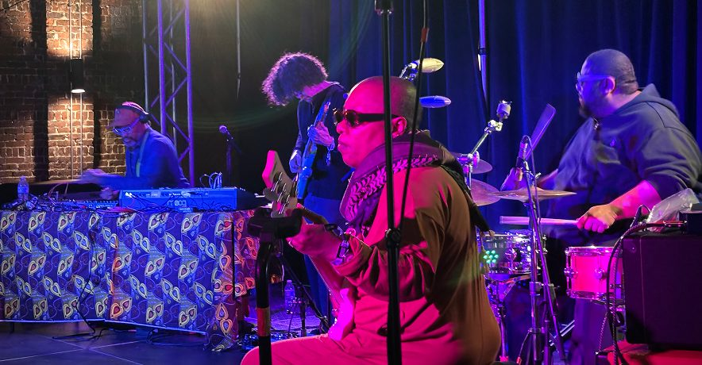

### [Zeena Parkins](https://zeenaparkinsprojects.bandcamp.com/) at Regas Square
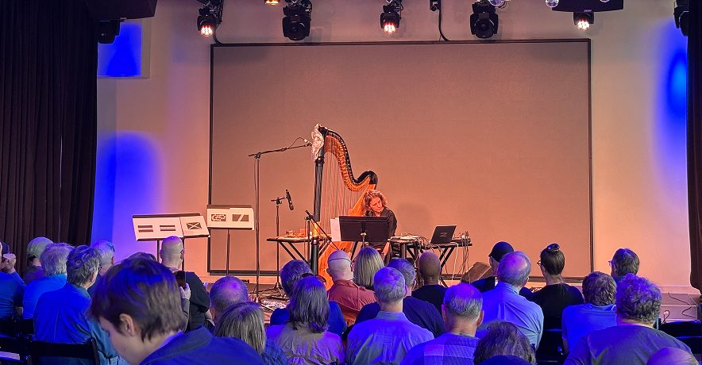

### [Michael Rother](https://www.michaelrother.de/): The Music of Neu! and Harmonia
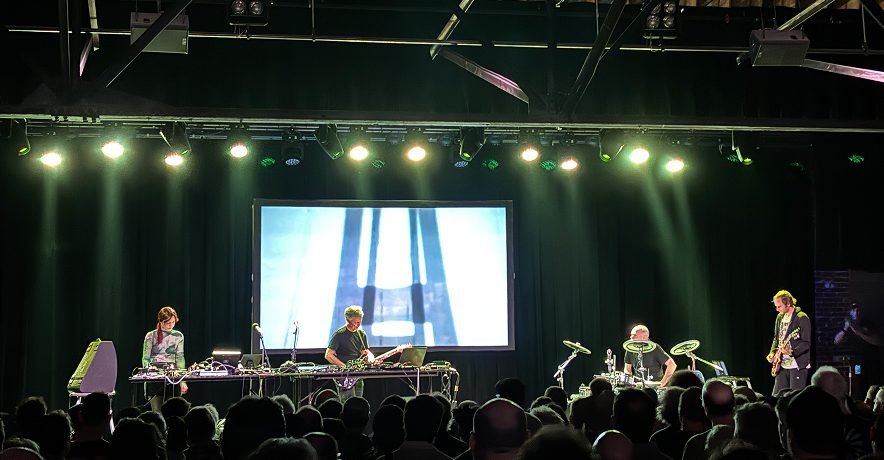

### [Beak>](https://beak.bandcamp.com/music) at Mill & Mine
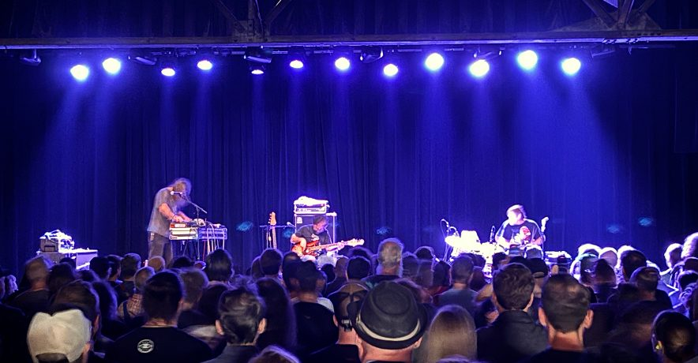

### 133 Years of Reverb at St. John's Cathedral
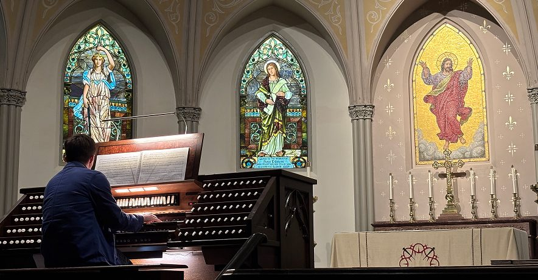
https://jamesmcvinnie.co.uk/ 

### [Steve Roach](https://steveroach.com/) at Church Street United Methodist
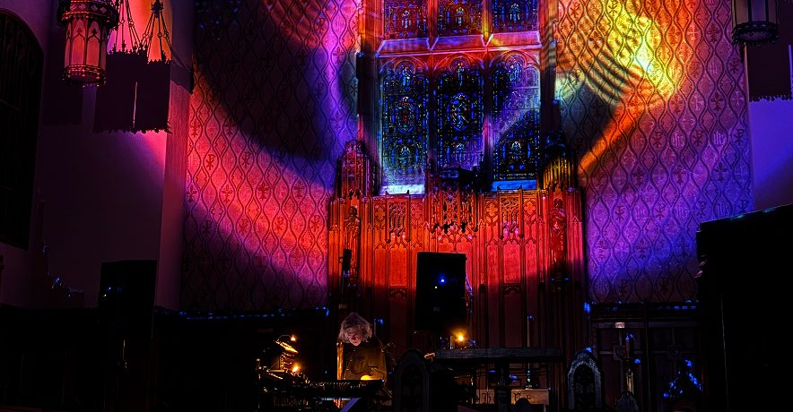

### [Waxahatchee](https://www.waxahatchee.com/) at Knoxville Civic Auditorium
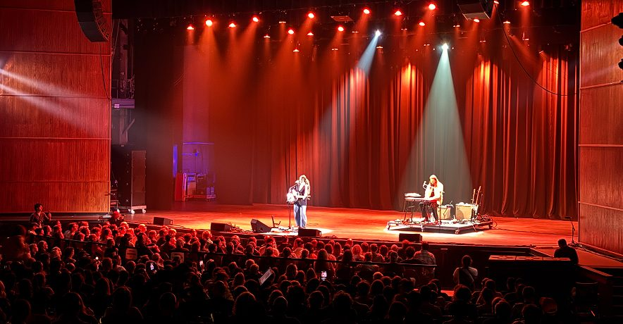

## Sunday - March 30, 2025

### [Dan Weiss Even Odds Trio](https://www.danweiss.net/) at The Standard
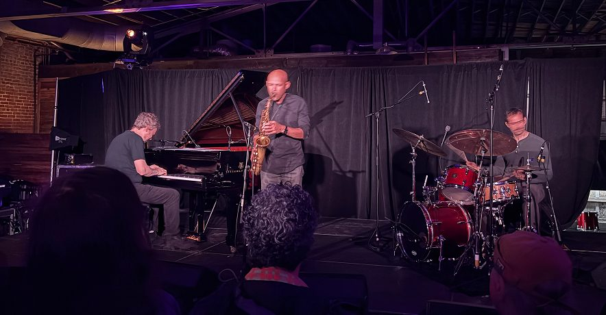

### [Laraaji](https://laraaji.blogspot.com/) at St. John's Cathedral
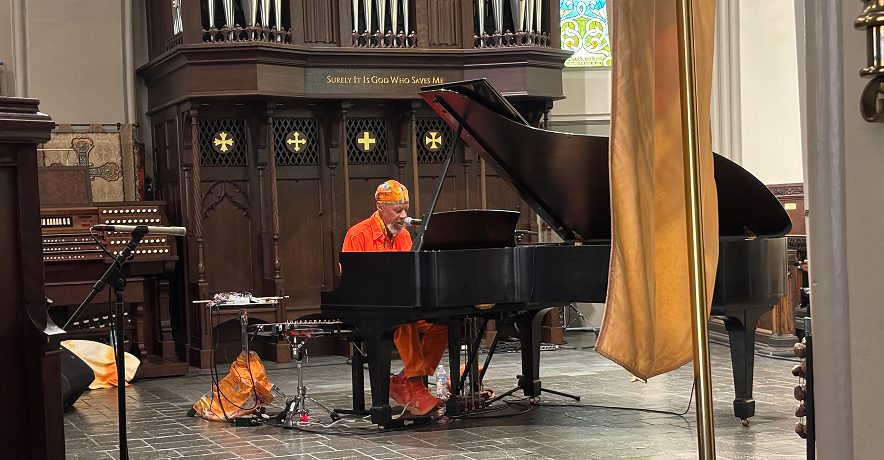

### [Mabe Fratti](https://www.instagram.com/mabefs) at Jackson Terminal
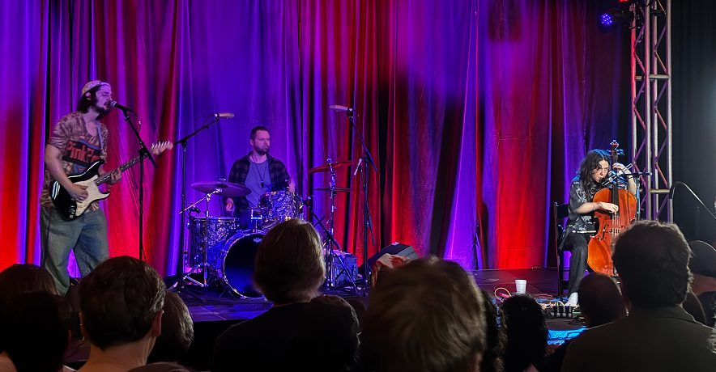

### [Fieldwork](https://vijay-iyer.com/) (Vijay Iyer / Steve Lehman / Tyshawn Sorey) at Bijou Theatre
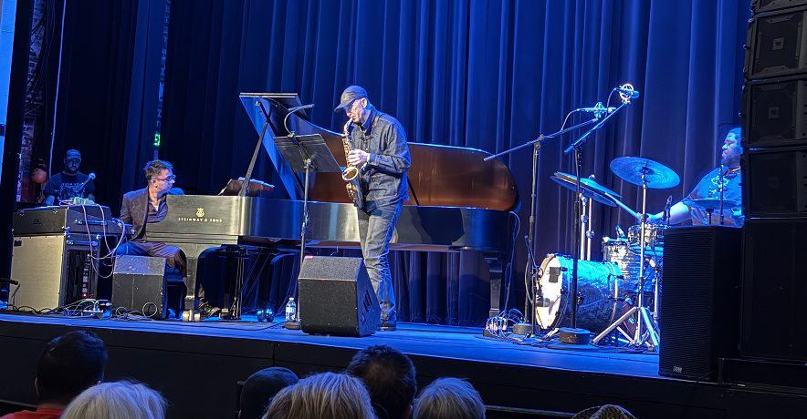

### [múm](https://mumband.bandcamp.com/) at Bijou Theatre
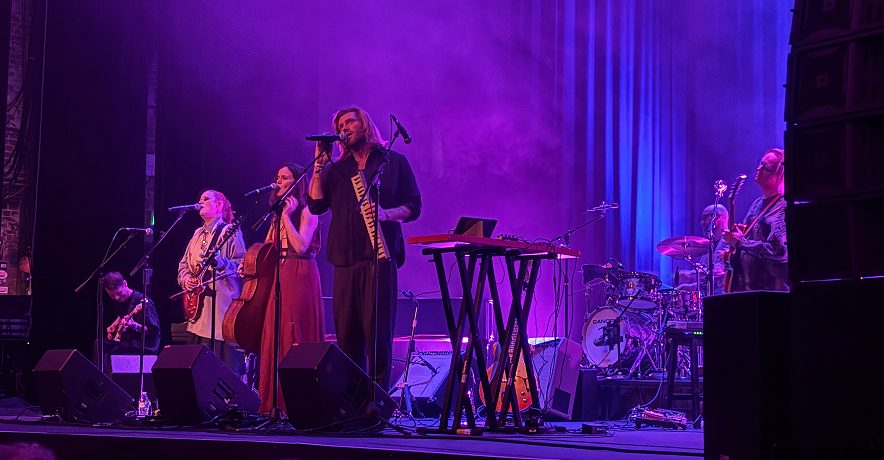

### [Explosions in the Sky](https://explosionsinthesky.com/) at Mill & Mine
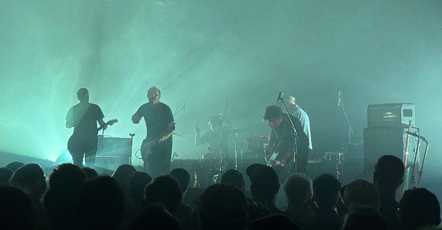