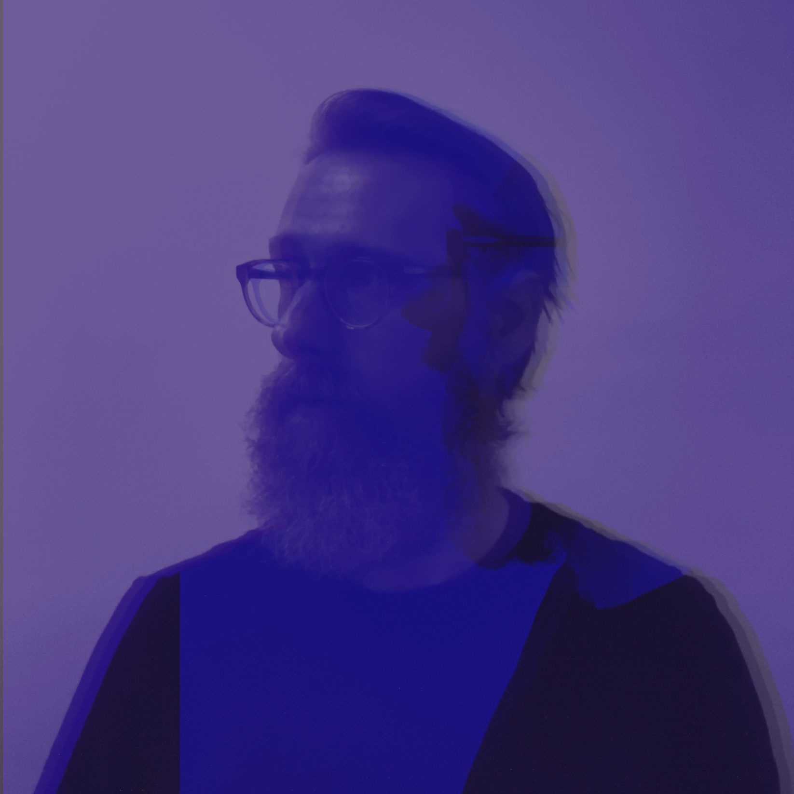




<section class="music-block" aria-labelledby="booking">
    <h2 id="booking">Booking and contact</h2>
    
For shows, interviews, and press requests.

    

        
    

</section>


<section class="music-block" aria-labelledby="photos">
    <h2 id="photos">Photos</h2>
    <figure class="press-photo">
        
        <figcaption>Photo: Line 47, 2024. 1646 × 1646 px.</figcaption>
    </figure>
    

        <a class="button button--secondary" href="/assets/images/L47-2024-small.jpg" download="Line47-press-photo-2024.jpg">Download photo (JPG, 1646 px)</a>
    

</section>

<section class="music-block" aria-labelledby="bios">
    <h2 id="bios">Bios</h2>
    
Three lengths. Open one and use the copy button to paste it into a listing.

    

    
Short bio (37 words)

    

Line 47 is the long-standing electronic project of Scott Weber (founder of Terminal Dusk Records), whose career spans three decades of breakcore innovation, EU tours alongside Ceephax Acid Crew, and a 2026 return to hardware-driven rhythmic complexity.

    

    <button type="button" class="button button--secondary copy-bio" data-target="bio-short">Copy short bio</button>

    
Medium bio (92 words)

    

Since 1994, Line 47 has been a central part of the American experimental electronic underground. From co-founding Sonicterror and creating Terminal Dusk record labels to touring Europe with Ceephax Acid Crew, Rusuden, and X&Trick, his influence on the breakcore and IDM landscape is profound. Following the 2021 release of Secret Acid World, Line 47 enters 2026 with a brand-new album that pushes his signature tracker-based production into new territories. Fusing intricate sequencing, Line 47 delivers a high-velocity live experience that bridges the gap between classic drill ’n bass and modern electronic abstraction.

    

    <button type="button" class="button button--secondary copy-bio" data-target="bio-medium">Copy medium bio</button>

    
Long bio (399 words)

    

<strong>Legacy and the European Circuit</strong> - Line 47 emerged from the 1994 industrial wreckage as a percussion-led exploration of rhythmic entropy, evolving from the tactile exploration of hand-etched vinyl and tape-loop “abstract concertos" into the rigid, high-velocity logic of the digital tracker. Moving from the post-rock fringe to the meticulous sequencing of Fasttracker 2 and Renoise, the project synthesized a signature of intricate breaks, and industrial-leaning electronica that commanded the mid-2000s global underground. This trajectory, defined by the intersection of acoustic chaos and machine precision was codified during a landmark 2006 European tour alongside Ceephax Acid Crew, Rusuden, and X&Trick, solidifying Line 47 as capable of navigating the furthest reaches of the breakcore and braindance continuum.

<strong>Label Vision and Sound Evolution</strong> - As a central architect of the North American underground, Line 47’s influence extends beyond composition into the structural curation of the genre. In 2000, he co-founded Sonicterror Recordings alongside Enduser, an imprint that achieved rapid global saturation by aggressively re-coding the boundaries of Breakcore and Jungle. Seeking a more expansive sonic vocabulary, he subsequently founded Terminal Dusk Records, a pivotal nexus for heavyweights like Soundmurderer, Doormouse, and Eight Frozen Modules. Through these platforms, he engineered a community that bridged the disparate frequencies of gabber, dub, and experimental electronics, defining the "US Sound" for a generation. Following a period of technical refinement, the 2021 release of Secret Acid World re-established the Line 47 project as a master of corrosive, acid-tinged textures and hyper-kinetic rhythmic structures, proving his output remains a sharp, essential component of the contemporary electronic continuum.

<strong>2026: The New Frontier</strong> - Entering 2026, Line 47 represents the apex of a 30-year trajectory in sonic deconstruction. This prolific new chapter is anchored by a forthcoming full-length LP, where Weber integrates decades of forensic production expertise into a high-fidelity, streamlined live environment. By synthesizing the rigid, hex-based sequencing of Renoise with the fluid modularity of Ableton Live and tactile hardware controllers, the performance has evolved into a fully immersive sensory experience. Weber now engineers his own synchronized visuals to mirror the hyper-edited rhythmic density of his sets—a clinical yet visceral journey through the frequencies of gabber, ragga, and IDM. For curators and festivals, Line 47 offers more than a performance; it is a live masterclass in the evolution of American electronic subculture, maintained through a staunchly independent, direct-to-fan infrastructure via the Terminal Dusk and Line 47 Bandcamp platforms.

    

    <button type="button" class="button button--secondary copy-bio" data-target="bio-long">Copy long bio</button>

</section>

<section class="music-block" aria-labelledby="listen">
    <h2 id="listen">Listen</h2>
    
</section>

<section class="music-block" aria-labelledby="rider">
    <h2 id="rider">Tech rider</h2>
    <!-- TODO: confirm every item below matches your current live setup before sharing this page. -->
    
Line 47 performs a live hybrid set from a laptop running Renoise and Ableton Live with hardware controllers, plus synchronized visuals.

    <h3>Provided by Line 47</h3>
    <ul>
        <li>Laptop, audio interface, and controllers</li>
        <li>Visuals laptop output (HDMI)</li>
    </ul>
    <h3>Needed from the venue</h3>
    <ul>
        <li>Table about 6 ft (1.8 m) wide, at standing height if possible</li>
        <li>Two grounded power outlets at the table</li>
        <li>Stereo feed to the house mixer: two balanced 1/4" or XLR inputs (or a stereo DI)</li>
        <li>One monitor wedge, or a booth monitor pair</li>
        <li>Projector or screen with HDMI input, if visuals are part of the show</li>
        <li>Line check of 15 minutes before doors</li>
    </ul>
</section>

